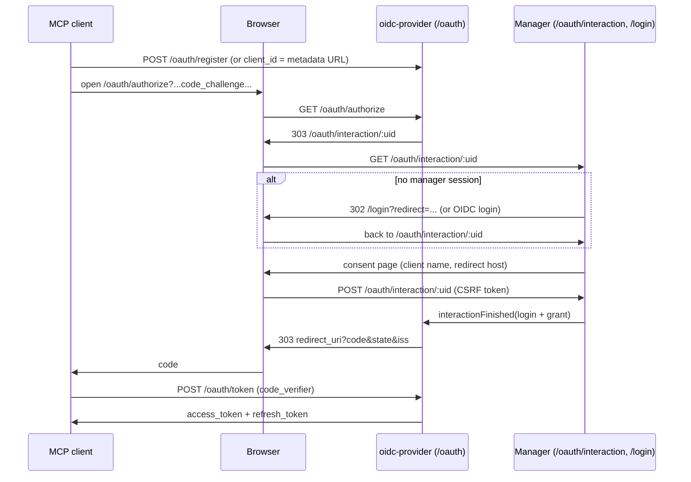

# OAuth 2.1 authorization server

The manager is its own authorization server for MCP clients (issue #511), built on [`oidc-provider`](https://github.com/panva/node-oidc-provider). A client configured with only `https://<manager>/mcp` discovers the server, registers itself, sends the user through the manager's normal sign-in, and gets a manager-issued token.

Follows the [MCP authorization spec 2026-07-28](https://modelcontextprotocol.io/specification/2026-07-28/basic/authorization): RFC 9728 protected resource metadata, RFC 8414 server metadata, Client ID Metadata Documents and RFC 7591 dynamic registration, PKCE S256, RFC 8707 resource indicators, RFC 9207 `iss`.

| Endpoint | Served by |
|---|---|
| `GET /.well-known/oauth-protected-resource[/mcp]` | manager (RFC 9728) |
| `GET /.well-known/oauth-authorization-server`, `/.well-known/openid-configuration` | provider, re-served at the origin root |
| `POST /oauth/register` | manager policy check, then provider (RFC 7591) |
| `GET /oauth/authorize` | provider (code + PKCE S256) |
| `GET/POST /oauth/interaction/:uid` | manager: sign-in check and consent page |
| `POST /oauth/token` | client-secret hashing, then provider (`authorization_code`, rotating `refresh_token`, `client_credentials` for owned clients) |
| `POST /oauth/revoke` | client-secret hashing, then provider (RFC 7009) |

## Files

| File | Role |
|---|---|
| `provider.js` | Provider configuration; one Provider per public origin, cached |
| `adapter.js` | Provider storage on the `OAuthPayloads` table; hashes tokens and client secrets |
| `repository.js` | Queries on `OAuthPayloads` |
| `router.js` | Three routers mounted at different points of `app.js` (see below) |
| `controller.js` | Interaction (sign-in check + consent), root discovery, pre-provider checks, errors |
| `service/policy.js` | Scope, TTLs, redirect URI policy, registration rules, `resource` check |
| `service/consent.js` | Client display info, creating the grant on approval |
| `service/client-auth.js` | Hash presented client secrets; move them to the registered auth method |
| `service/metadata.js` | Protected resource metadata |
| `service/access-tokens.js` | Bearer validation for `apiAuth` and the `/mcp` gate |
| `service/grants.js` | List and revoke grants ("Authorized apps", `resources/oauth-grants`) |
| `service/owned-clients.js` | Client-credentials clients owned by a user (`resources/oauth-clients`) |
| `service/sweep.js` | Removes expired records, dead grants, unused dynamic clients |

## Decisions

- **`oidc-provider`, not hand-rolled.** It implements the protocol (PKCE, code binding, refresh rotation with reuse detection, client authentication, Client ID Metadata Documents with an SSRF-guarded fetch, `iss`, resource indicators); the manager keeps sign-in, consent, storage and policy. It's ESM-only; Node 24 (what the manager runs) loads it from CommonJS with `require()`. Jest can't, so tests load it through `tests/oidc-provider-native.js`.
- **Sign-in is the existing login.** The provider's interaction URL is `/oauth/interaction/:uid`. Without a manager session it redirects to `/login?redirect=…`, or straight to the OIDC login when OIDC is enabled. The provider's own login step is answered silently from the manager session.
- **Two sessions, one source of truth.** The provider keeps an internal session; the manager session always wins. If they disagree (another user signed in), the stale provider session is deleted and the authorization restarts. Tokens don't expire with the provider session (`expiresWithSession: false`).
- **Issuer per origin.** A Provider's issuer is fixed at construction, but the manager derives its public origin from each request (`trust proxy`). Providers are cached per origin (LRU of 16, since Host headers are client-controlled); they share one database.
- **Middleware placement.** `/.well-known/*` and the provider at `/oauth` are mounted before the body parsers, session and `csrfGuard` (clients have neither a session nor a Bearer token). `/oauth/interaction` is mounted after them; the consent POST is CSRF-protected.
- **One scope, `manager`.** Tokens carry the user's full permissions, like API keys. Admin status is derived from group membership on every request.
- **Secrets at rest.** Token-like records are keyed by SHA-256 of the token, and the copy of the token inside the payload (`jti`) is hashed too. Client secrets are stored as `sha256:<hex>`; `service/client-auth.js` hashes the presented secret before the provider compares it.
- **Audience = manager origin.** The MCP server (`manager-control-program`) forwards the caller's token to `/api/v1` on the same manager (`ForwardAuthorizationHeader`). Both are served by the same origin and trust the same authorization server, so one audience covers `/mcp` and `/api/v1`. This is not the token passthrough the MCP spec forbids: the token never goes to a service with a different authorization server.
- **Client credentials act as the client's owner.** A user creates a confidential client on the API keys page (issue #518); its tokens act as that user, bounded by the user's permissions, like an API key. The owner lives in the row's `accountId` column, written only by the manager. No service accounts: they'd need their own permission model. Dynamically registered clients can't use the grant (refused at registration) and metadata-document clients can't hold secrets.
- **Open registration guardrails.** Rate limits; redirect URI policy (https, loopback http on any port, private-use schemes like `vscode://`) checked before the provider; PKCE S256 only; no implicit flow; consent page with client name and redirect host on every authorization; rotating refresh tokens; revoking any token revokes the grant's tokens; sweep of unused clients.
