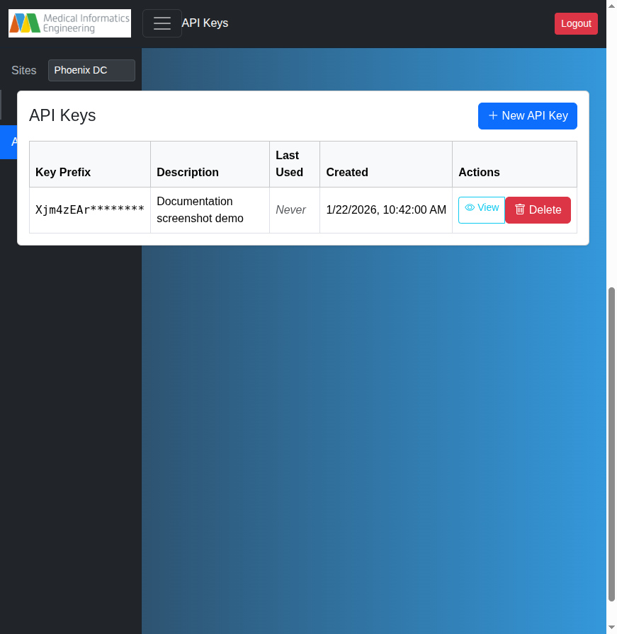
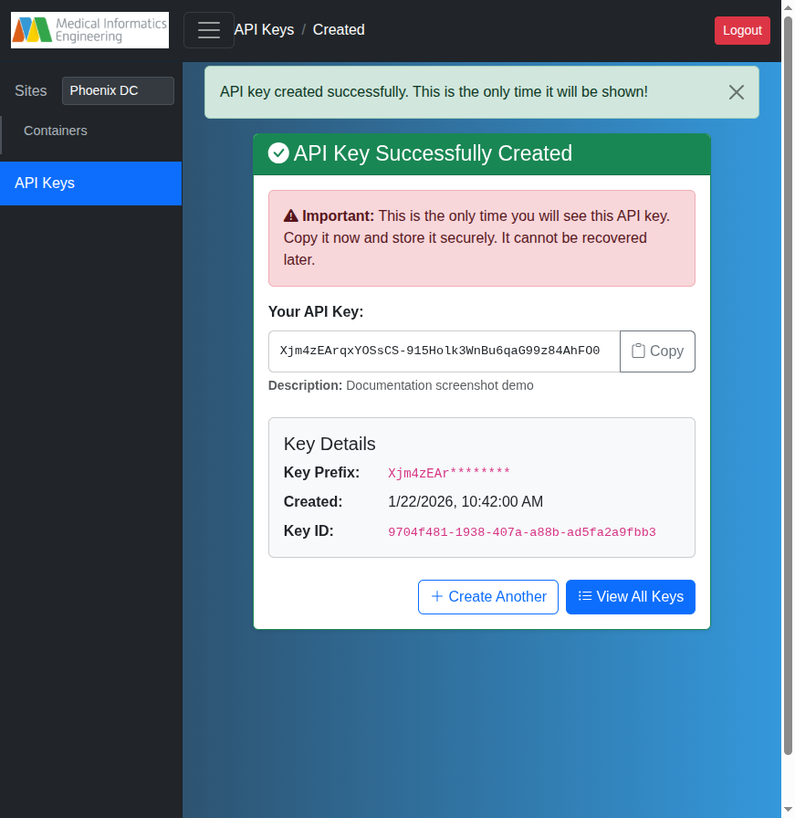
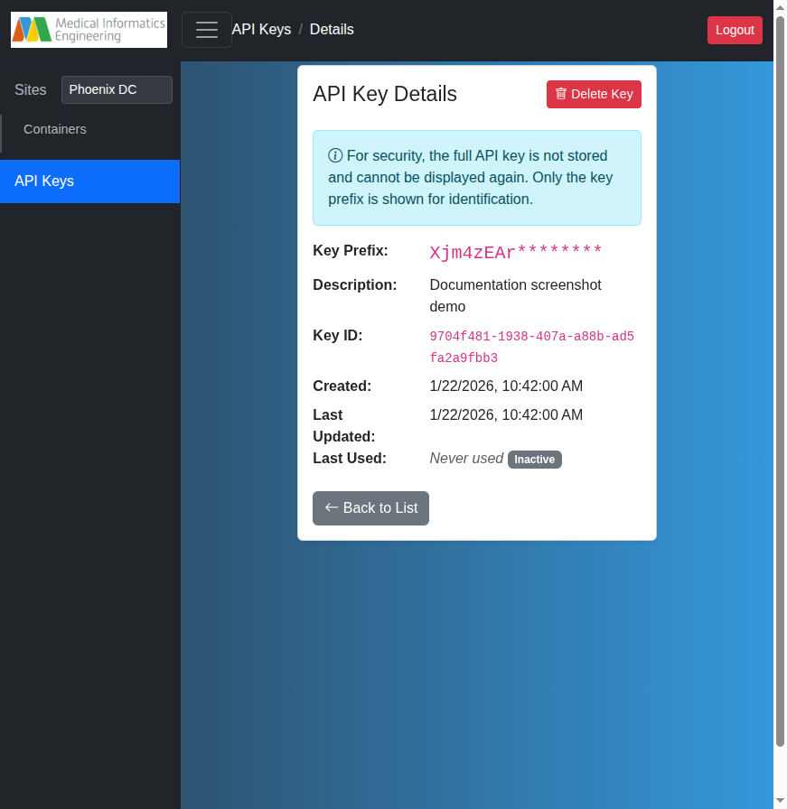

# API Keys

API keys authenticate API requests without using your password.

## Managing API Keys

Navigate to **API Keys** from the main navigation.



### Creating a Key

1. Click **"+ New API Key"**
2. (Optional) Enter a description (e.g., "CI/CD pipeline")
3. Click **"Generate API Key"**



!!! danger "Critical"

    The full key is shown only once. Copy it immediately. The server stores only a hash — lost keys cannot be recovered.

### Viewing Key Details

Click **View** on any key to see its prefix, description, creation date, and last-used timestamp.



### Deleting a Key

Click **Delete** from the list or details page. Other keys and your password are unaffected.

## Using Your API Key

Pass the key as a Bearer token and request JSON responses:

```bash
curl -H "Authorization: Bearer YOUR_API_KEY" \
     -H "Accept: application/json" \
     https://your-server/apikeys
```

For the full list of available endpoints, request and response schemas, and a "Try it out" console, visit the [interactive API documentation]({{ manager_url }}/api) at `/api` on your server.

## Authorized Apps

The **Authorized apps** section on the same page lists applications you signed in to with OAuth, such as MCP clients that connected with only the server URL (see [MCP Server](../mcp-server.md)). Each row shows the application name, where it redirects after sign-in, and when it was last used. Names marked **Unverified** were supplied by the application itself.

Click **Revoke** to cut an application off immediately: its next request is rejected and it has to sign in again. Admins can switch on **All users** to see and revoke every user's authorized apps.

## OAuth Clients (Client Credentials)

For machines that speak OAuth (CI jobs, bots, MCP clients using the [client credentials extension](https://github.com/modelcontextprotocol/ext-auth)), create an **OAuth client** on the same page. You get a client ID and a client secret; the secret is shown once. The client acts as you, with your permissions, exactly like an API key.

Exchange them for a 1-hour access token, then call `/mcp` or `/api/v1` with it:

```bash
curl -s https://your-server/oauth/token \
  -d grant_type=client_credentials \
  -d client_id=YOUR_CLIENT_ID -d client_secret=YOUR_CLIENT_SECRET
# → {"access_token":"…","token_type":"Bearer","expires_in":3600,"scope":"manager"}
```

HTTP Basic (`-u YOUR_CLIENT_ID:YOUR_CLIENT_SECRET`) works too. Deleting the client revokes its tokens immediately.

### API Key or Client Credentials?

| | API key | OAuth client credentials |
|---|---|---|
| Sent on each request | the key itself | a short-lived access token (1 h) |
| Leaked request credential | valid until you delete the key | expires within an hour |
| Client support | anything that can set a header | OAuth-aware tools and MCP clients |
| Acts as | you | you |

Use an API key for scripts and `curl`. Use client credentials when the tool expects OAuth, or when you want the credential that travels on every request to expire on its own.
